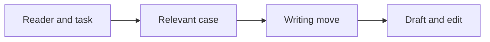

# copywriting-learning

[简体中文](README.zh-CN.md) · [See it in action](#see-it-in-action) · [Find your task](#find-your-task) · [Explore the library](#inside-the-library) · [Get started](#get-started)

## Find the right angle. Make every word earn its place.

Turn product facts, customer questions, and rough drafts into English copy that gives people a reason to read, something worth remembering, and a clear next step.

Sometimes you know your product inside out but haven’t found the detail that makes its value click. Sometimes a prospect goes quiet, a headline feels flat, or a draft says everything except what matters most. `copywriting-learning` helps you work through those moments—from choosing the message to finding the words.

**v1.3.0 · 46 bilingual cases and exercises · 27 searchable methods**

## See it in action


> I met a prospect at a trade show whose needs seemed like a good fit for our products. After our conversation, I sent an email and then a product catalog. They stopped replying. How can I get them interested again?

Here the useful deliverable is a **follow-up plan**. The brief gives a sequence of events. The buyer may need help finding a suitable model, may have an unanswered question, or may have put the project on hold. The previous exchange is where to check.

**Before · Give the buyer more work.** A common closing is “Please review the catalog and let me know if you have any questions.” The buyer has to find the right pages and work out what to ask.

**After · Give the buyer something to decide.** If your booth notes establish the application, point to one or two relevant options. Explain the one difference that changes the choice, then ask about that requirement. This is one possible route for the brief above.

- **Know the application?** Prepare the relevant catalog pages, a shortlist, and one meaningful difference.
- **Have an unanswered question?** Return to it with a confirmed answer, a diagram, or the one detail that still needs checking.
- **Have a comparable application?** Explain how it works and where its conditions differ. If the previous exchange shows a timing issue, ask when the project will be reviewed.

**Inside the skill.** M-001 directs attention to the buyer's task, M-019 sets up a clear next step, and M-024 provides criteria for choosing a comparable application. [Sugarman’s scale inquiry](copywriting-learning/library/cases/en/C-sugarman-scale-buyer-questions.md) shows how a description can leave one buying question unanswered. [Zebra × Saddle Creek](copywriting-learning/library/cases/en/C-zebra-saddle-creek-workflow-proof.md) shows how to explain technical details through the buyer’s work.

[Read the full walkthrough, including three English email structures and a materials checklist](docs/trade-show-follow-up.md)

## Find your task

The examples below are original exercises. Each shows a different kind of deliverable.

### Advertising & marketing

A notebook pairs a blank left page with a ruled right page. That layout gives the ad a concrete idea about making room for unfinished work.

> **Room for the rough draft.**  
> Sketch on the left. Shape the words on the right.

[Case: follow a feature to a benefit the reader cares about](copywriting-learning/library/cases/en/C-vgc-benefits.md)

### Customer communication

A prospect says, “Your price is too high.” The seller can review the competing scope, and the reply makes it easy to share the detail that would help.

> Thanks for being direct. Could you share what the other quote includes, particularly delivery and support? I can compare it with ours and explain any differences.

[Case: find the missing information before recommending a next step](copywriting-learning/library/cases/en/C-sugarman-scale-buyer-questions.md)

### Product benefits

A removable divider frees up the whole compartment. The intended longer tools have been checked for fit, so the page can say what the change lets the buyer do.

> **Make room for the longer tools.**  
> Remove the divider to open up the full compartment.

[Guide: go from a confirmed fact to a concrete use and its conditions](copywriting-learning/references/writing.md#从事实推到可写的利益)

### Draft diagnosis & refinement

The original sentence gets the sequence right. The revision keeps the fit check and puts the action up front.

> **Before:** Before you proceed with placing an order, we recommend that you first check whether the sample fits your existing holder.
>
> **After:** Before ordering, check that the sample fits your existing holder.

[Guide: choose how to revise a draft](copywriting-learning/references/writing.md#选择写法)

### Learning from examples & feedback

The Rolls-Royce ad makes quietness imaginable through one small sound. A later brief might use the same technique with a different product and a detail its own evidence supports. Save the observation, the technique, and its limits together so the next task can find them.

[Case: study how a specific detail carries a quality claim](copywriting-learning/library/cases/en/C-rolls-royce-specific-detail.md)

## How it works



Describe what the reader needs to decide. The skill uses that problem to find a case, reads the relevant records, and adapts the writing move to your facts and channel. A higher price, for example, can point to [Shell’s fleet oil case](copywriting-learning/library/cases/en/C-shell-fleet-saving-calculation.md), where costs can be compared using the buyer’s actual operating figures.

**Case selection helps decide what to say and in what order.** Editing decides where a concrete noun, a stronger verb, a pause, or a shorter sentence will do the most work. Keep any condition or evidence the reader needs to judge the claim.

A full email or product page usually gets one main draft. When you’re exploring headlines or opening hooks, ask for two or three distinct angles and a brief explanation of the reader and case technique each one suits.

[Writing guide (Chinese)](copywriting-learning/references/writing.md) · [Background on case-based reasoning](https://www.iiia.csic.es/~enric/papers/Aamodt_1994_Case.pdf)

## Inside the library

The library includes advertising cases from Ogilvy and Sugarman, 18 VeryGoodCopy Micro-Lesson notes, and public brand examples. The new [Xiaomi SU7 teardown](copywriting-learning/library/cases/en/C-xiaomi-su7-2026-capri-blue-billboard-copy.md) looks at how a color can suggest a change of pace. Two methods from Steve Krug cover writing for readers who scan, homepage taglines, and FAQs that answer real questions.

A useful edit can go back into the library. Bring a source, a revision you made, or feedback you can verify. The skill can show you a proposed entry with the source and the reusable move. After you approve it, the library tool checks the update, keeps a backup, and saves it as a new revision. Keep an editor’s wording preference, a customer’s reply, and measured campaign results in their own evidence categories.

[English case index](copywriting-learning/library/README.en.md) · [中文案例目录](copywriting-learning/library/README.md) · [Learning guide (Chinese)](copywriting-learning/references/learning.md) · [Changelog](CHANGELOG.en.md) · [Maintenance](MAINTAINING.en.md)

## Get started

Download a release and extract the **inner `copywriting-learning` folder** into your agent's skills directory. For a Codex project, place it in the project’s `.agents/skills/` directory. Keep `SKILL.md` and its folders together. The bundled library commands use Python 3.9 or later.

[Download a versioned release](https://github.com/XavierCrea/copywriting-learning/releases)

Tell the skill **what to write and where it will appear**, **who will read it and what they should do next**, and **which facts, selling points, or constraints they can rely on**. A few notes or a rough draft are enough to start. You can brief it in Chinese or English and request English copy.

```text
Use copywriting-learning to write an English ad for a notebook.
Readers sketch before they write. Each spread has a blank left page
and a ruled right page. Give me a headline and a supporting line.
Use only those product facts. Explain the writing move in one sentence.
```

<details>
<summary>Search by problem, open cases in a batch, or validate the library</summary>

Run these commands from the folder that contains `SKILL.md`.

```bash
python3 scripts/library.py search "pricing objection" --kind cases --limit 3
python3 scripts/library.py get M-005 M-013 C-shell-fleet-saving-calculation
python3 scripts/library.py search "billboard" --kind cases --origin co_dissected_teardown
python3 scripts/library.py validate
```

Use `--origin` to narrow a search by where the material came from. Case results include the paths to available Chinese and English cards, relative to the library. See the maintenance guide for custom libraries and reviewed updates.

[Catalog and update format (Chinese)](copywriting-learning/references/knowledge-contract.md) · [Maintenance](MAINTAINING.en.md) · [Report an issue](https://github.com/XavierCrea/copywriting-learning/issues)

</details>
