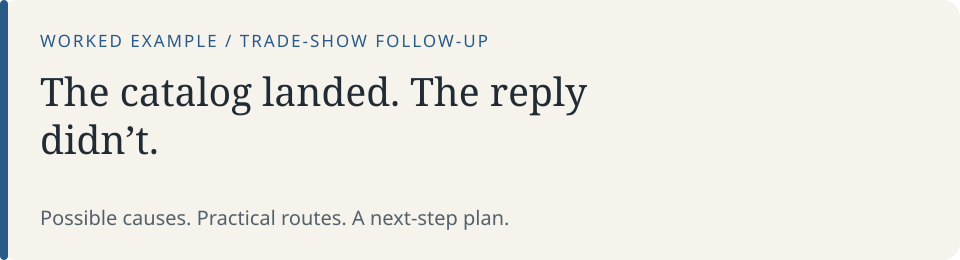

# copywriting-learning

[简体中文](README.zh-CN.md) · [See it in action](#see-it-in-action) · [Get started](#get-started)

## Find the right angle. Make every word earn its place.

Turn product facts, customer questions, and rough drafts into English copy that gives people a reason to read, something worth remembering, and a clear next step.

Sometimes you know your product inside out but haven’t found the detail that makes its value click. Sometimes a prospect goes quiet, a headline feels flat, or a draft says everything except what matters most. `copywriting-learning` helps you work through those moments—from choosing the message to finding the words.

Drawing on documented advertising cases, marketing examples, and writing lessons, it helps you uncover a relevant benefit, anticipate a reader’s question, build a persuasive sequence, and give an idea a more distinctive expression. Use it to shape an ad, explain a product, write an email, respond to a customer, or sharpen a draft that isn’t quite there yet.

The craft lives in the details: a concrete image that makes an abstract benefit tangible; a verb that brings a sentence to life; a pause that gives an idea weight; a shorter line that keeps everything essential. Each choice should serve your reader, your purpose, and the facts you can support.

You can also bring it an advertisement worth studying, a passage from a book, or feedback from your own work. Ask it to extract a reusable lesson and, with your approval, save that lesson with its source and limits for future tasks.

**v1.1.2 · 45 sourced cases and exercises · 24 searchable methods**  
[Explore the library](copywriting-learning/library/README.en.md) · [Changelog](CHANGELOG.en.md)

## See it in action



**01 · The problem, in the user's words**

> I met a prospect at a trade show whose needs seemed like a good fit for our products. After our conversation, I sent an email and then a product catalog. They stopped replying. How can I get them interested again?

That is the whole brief. The product, the buyer's exact requirements, and the reason for the silence are unspecified. The skill can still deliver **plausible explanations, actionable follow-up routes, a materials checklist, and a plan for what to do next**. The email structures below illustrate those routes; they are not ready-to-send messages or evidence of campaign results.

**02 · Inside the skill**

| Records consulted | How they inform the plan |
| --- | --- |
| **M-001 · Research the product and buyer** | Reconnect the catalog to the customer's task and the questions raised at the booth. |
| **M-019 · Make the next step clear** | Give each follow-up one useful, manageable next step and explain what happens after the reply. |
| **M-024 · Select relevant customer evidence** | Offer a comparable real application when suitable material exists; identify what must be checked before using it. |
| [**Sugarman's scale inquiry**](copywriting-learning/library/cases/C-sugarman-scale-buyer-questions.md) | A seller's apparently complete description can still leave a buying question unanswered. |
| [**Zebra × Saddle Creek**](copywriting-learning/library/cases/C-zebra-saddle-creek-workflow-proof.md) | Explain features through the customer's work, so their relevance becomes concrete. |

[Read the method records](copywriting-learning/library/catalog.json). These cases guide the analysis and writing choices; their products, customer situations, and results do not become facts about this prospect.

**03 · What might be getting in the way?**

| Possible obstacle | What to look for in the previous exchange | Useful response |
| --- | --- | --- |
| **The catalog leaves the selection work to the buyer.** | Many products, but no explanation of which options relate to the discussion. | Narrow the options and explain the selection criteria. |
| **One important answer is still missing.** | A question about fit, certification, delivery, or implementation that the catalog does not resolve. | Answer it with a relevant specification, diagram, or other supporting material. |
| **The next step is unclear.** | A closing such as “Review the catalog and let me know if you have questions.” | Offer one concrete way to continue. |
| **The project's timing or priority has changed.** | Product information may already be sufficient, but there is no update on evaluation or purchasing. | Make it easy to explain the project's current status. |

These are hypotheses to investigate, not a diagnosis of the buyer. In Sugarman's case, capacity did not answer buyers' questions about the scale's own weight. The transferable lesson is to look for a missing decision input—not to assume that this prospect also needs weight information.

**04 · Three practical ways to restart the conversation**

The aim is to give the buyer a reason to engage again and make one small decision. That could be confirming a condition, comparing options, or clarifying timing.

**Route A · Turn the catalog into a relevant shortlist**

Use this when you know the general application but have not settled on a model. Select **one or two candidates worth evaluating**. Explain why each relates to the known need, the meaningful difference between them, and the condition that would decide the choice.

| Candidate | Connection to the need | Selection condition |
| --- | --- | --- |
| A | Which stated task or requirement it addresses. | When it is worth evaluating first. |
| B | Which relevant capability differs. | When that difference matters. |

**Prepare:** booth notes, the relevant catalog pages, candidate specifications, and one clear distinction.  
**Look for:** confirmation of a requirement or a correction to your understanding.  
**Library connection:** M-001 and Zebra's workflow approach—show why a feature matters to this customer's work.

<details>
<summary>Route A · English email structure</summary>

Use after completing the shortlist; replace the placeholders with supported details.

> **Subject: Two options for the [application] we discussed**
>
> Hi [Name],
>
> Following our conversation at [Show], I've narrowed the catalog down to two options for [application].
>
> **[Model A]** is worth considering if [condition A].  
> **[Model B]** offers [verified difference], which may matter if [condition B].
>
> Is [one deciding requirement] essential for your project? That would help narrow the choice.

If only one candidate merits evaluation, describe that one. Ask about a single condition that changes the recommendation; don't turn the email into a requirements questionnaire.

</details>

**Route B · Return to the question that was never fully answered**

Use this when the buyer raised a specific issue at the booth, or a recommendation depends on one unresolved condition. Check questions about integration, requirements, customization, sample evaluation, or delivery. Put any answer you already have first; then explain why the remaining detail matters.

**Prepare:** the customer's question, a supported answer, the relevant specification or diagram, and one remaining condition if needed.  
**Look for:** confirmation of the requirement or a more specific technical or commercial discussion.  
**Library connection:** Sugarman's buyer inquiries—use an actual question to locate a decision obstacle.

<details>
<summary>Route B · English email structure</summary>

> **Subject: On your question about [requirement]**
>
> Hi [Name],
>
> At [Show], you asked whether [specific question].
>
> [Direct answer supported by your product or service information.]
>
> The point that still needs checking is [condition], because it determines [practical consequence].
>
> Could you confirm [one specific detail]? I can then [a concrete next step you can deliver].

Share an available answer or relevant excerpt in the message. If nothing remains to be checked, remove the extra question and offer the next step that fits the conversation.

</details>

**Route C · Show how a comparable application works**

Use this when the application is understood, the buyer needs help assessing implementation, and you have a relevant example you can share. Build a short application note:

**Comparable task → configuration or approach → documented result → differences to check.**

Explain how the setup fits an existing process or meets a particular requirement. A recognizable customer name alone does not establish suitability.

**Prepare:** shareable application material, configuration, operating conditions, evidence for any result, and meaningful differences from the prospect's needs.  
**Look for:** interest in reviewing the details or discussing the application.  
**Library connection:** M-024 and Zebra—use comparable conditions and concrete work to make the example useful. If no customer case fits, use specifications, test material, or a clearly identified demonstration instead.

<details>
<summary>Route C · English email structure</summary>

> **Subject: An application example relevant to [project]**
>
> Hi [Name],
>
> Our conversation about [requirement] brought this application to mind.
>
> In [a real, shareable application], [specific configuration or approach] was used to [documented task].
>
> The relevant similarity is [shared condition]. One difference we would need to check is [difference].
>
> Would the [configuration diagram / application summary] be useful for your evaluation?

</details>

**05 · Choose a route and plan the next move**

- **A specific question remains unanswered:** start with Route B and follow through on the discussion you already had.
- **Only a general catalog has been sent:** start with Route A and make the selection easier.
- **The fit is broadly understood and a relevant application is available:** use Route C to support evaluation.

Choose one main obstacle per follow-up. These are alternatives, not three sections to combine into one long email.

| Stage | Action | What completion looks like |
| --- | --- | --- |
| **Review the exchange.** | Find the stated use, key questions, and any promised follow-up; check the address and any delivery failures. | You can describe the buyer's next decision in one sentence. |
| **Prepare one useful item.** | Make the shortlist, targeted answer, or application note for the chosen route. | The buyer can see the relevant information without reading the whole catalog. |
| **Follow up with new value.** | Reconnect to the booth conversation, give the useful information, and offer one main next step. | The buyer knows why to respond and what will happen next. |
| **Adapt to the response.** | Supply technical details for technical questions; clarify comparison terms for price questions; agree on timing if the project is delayed. | The next action reflects what the customer actually says. |

If a useful follow-up still gets no response, a later message can ask about timing:

> Is [project] still under evaluation, or would it be better to reconnect later?

Respect a stated delay. If silence continues, reduce the frequency and reconnect when you have information relevant to the need.

**Start here:** put one need the customer expressed next to one concrete piece of help you can offer. That connection gives the next contact a reason to exist.

<details>
<summary>Try this task with the information you already have</summary>

```text
Use copywriting-learning to help me with this problem:
I met a prospect at a trade show whose needs seemed like a good fit for our
products. After our conversation, I sent an email and then a catalog.
They stopped replying. How can I get them interested again?

Based on this information, explain plausible obstacles, propose practical
follow-up routes and when to choose each, and list the materials and next
steps for each route. Use relevant cases and explain what you borrow.
Keep unknowns as hypotheses. Use English templates where they help explain
the approach; a ready-to-send email is not required.
```

</details>

## Five ways to put it to work

These are original demonstrations, not historical ad quotations or measured campaign results. Product details below are fictional exercise inputs. Each card highlights a different kind of work; the prompts and drafts remain selectable text.

### Advertising & marketing


**The facts are there. Where is the idea?**

**Exercise facts:** a notebook pairs a blank left page with a ruled right page.

> **Room for the rough draft.**
> Sketch on the left. Shape the words on the right.

<details>
<summary>Try this task · see the writing move</summary>

The headline gives a physical feature a creative purpose; the supporting line makes the page layout explicit. The benefit remains tied to the supplied design.

```text
Use copywriting-learning to write an English notebook ad. Each spread has a blank left page and a ruled right page. Write for people who sketch before writing. Give me one headline and a supporting line; don’t invent paper quality or productivity claims.
```

[Benefits: follow a feature to a relevant use](copywriting-learning/library/cases/C-vgc-benefits.md)

</details>

### Customer communication


**“Your price is too high.” What next?**

**Exercise context:** a customer compares two quotations; the competing scope is unknown. The seller can review scope but has not authorized a discount.

> Thanks for being direct. Could you share what the other quote includes—particularly delivery and support? I can compare it with ours and explain any differences.

<details>
<summary>Try this task · see the writing move</summary>

The reply acknowledges the objection, asks for comparison facts, and promises only a review. It does not invent a superior service or offer an unauthorized discount.

```text
Use copywriting-learning to reply in English to “Your price is too high.” Our quote: [...]. What we know about the competing offer: [...]. Ask for the missing comparison detail without assuming our offer is better or promising a discount.
```

[Find the information needed for a decision](copywriting-learning/library/cases/C-sugarman-scale-buyer-questions.md)

</details>

### Product benefits


**You have specifications. What should the reader care about?**

**Exercise facts:** a tool case has a removable divider; fit for the intended longer tools has been checked.

> **Make room for the longer tools.**
> Remove the divider to open up the full compartment.

<details>
<summary>Try this task · see the writing move</summary>

One physical feature becomes one useful action. The draft does not jump from adjustable storage to unverified time savings or productivity.

```text
Use copywriting-learning to turn these confirmed features into an English product headline and supporting line: [...]. Reader and task: [...]. Show the link between feature and use. Keep any fit limits.
```

[Choose the benefit the facts can support](copywriting-learning/library/cases/C-vgc-benefits.md)

</details>

### Draft diagnosis & refinement


**Correct English. Still too much work to read?**

**Exercise input:** the original draft below supplies the facts.

> **Before:** Before you proceed with placing an order, we recommend that you first check whether the sample fits your existing holder.
>
> **After:** Before ordering, check that the sample fits your existing holder.

<details>
<summary>Try this task · see the writing move</summary>

The revision preserves the sequence, the sample, and the existing holder. It removes scaffolding rather than deleting the condition that matters.

```text
Use copywriting-learning to tighten this English draft: [...]. Preserve facts, conditions, timing, terminology, and promises. Give me one revision and explain the most important wording changes.
```

[Writing guide: compress without changing meaning](copywriting-learning/references/writing.md)

</details>

### Learning from examples & feedback


**What can you actually reuse from an ad you admire?**

**Example source:** the Rolls-Royce case in the library.

> **Observation:** a small, familiar sound gives the reader a way to imagine quietness.
> **Reusable move:** find a concrete, supported detail that expresses an abstract quality.
> **Limit:** the next product needs its own evidence; the historical claim does not transfer.

<details>
<summary>Try this task · see the writing move</summary>

A learning record separates observation, interpretation, application, and limits. A later task can retrieve the move without borrowing another product’s claims.

```text
Use copywriting-learning to analyze this accessible ad or source: [...]. Separate observations from interpretations and reported results. Extract a reusable writing move and its limits. Show me the proposed record before saving it.
```

[Study the detail and the evidence behind it](copywriting-learning/library/cases/C-rolls-royce-specific-detail.md)

</details>

## Case reasoning & writing craft

**Understand the problem → retrieve a relevant case → adapt the move → refine the words.**

You don’t need to know a method number or pick a case yourself. Describe the task and supply the facts. The skill searches for a comparable writing problem, reads the relevant records, checks where the comparison holds, and writes for your reader and channel. When no case fits, it works from your facts and applicable methods rather than forcing a match.

Case selection helps decide **what to say and in what order**. Writing craft shapes **how the idea lands**: choose the benefit that matters, make abstract qualities concrete, use a short scene where appropriate, sharpen verbs, shape rhythm, and cut repetition while preserving meaning. Wordplay earns its place only when both meanings serve the message.

[Writing guide (Chinese)](copywriting-learning/references/writing.md) · [Case-based reasoning: Aamodt & Plaza](https://www.iiia.csic.es/~enric/papers/Aamodt_1994_Case.pdf)

## Build on what you learn

Bring a source the agent can read, a draft you revised, or feedback you can verify. Ask it to identify the writing move, the conditions under which it applies, and the evidence for any reported result. Review the proposed entry and authorize saving it to your writable library.

**Source → observation → reusable move → limits → approved record → retrieval in a later task.**

A note such as “this sounded like a mass email” is editorial feedback. A customer reply is evidence of that reply. Neither alone proves a sales lift. Records keep their sources, scope, and revisions so later work can build on what is actually known.

Learning here means updating external records. It does not retrain the model or run an automatic background research process. [Learning workflow (Chinese)](copywriting-learning/references/learning.md)

## Get started

Download [the skill release](https://github.com/XavierCrea/copywriting-learning/releases/latest), extract it, and keep the entire inner `copywriting-learning` folder together. The README on the default branch may be newer than the documentation bundled in the release.

For local Codex use, place that folder in your project’s `.agents/skills/` directory. Other skill-capable agents have their own installation conventions; follow your agent’s instructions. Python 3.9+ is required for the bundled library search script. The agent needs file access to the skill and library; web research needs a browsing tool, and saving learning records needs write access.

Give it three things:

1. **The deliverable and channel:** an ad, email, product page, reply, or revision; include length and tone constraints.
2. **The reader and purpose:** who will read it, what they need to decide, and the next step you want to offer.
3. **The facts and materials:** confirmed features, conditions, customer words, a source, or an existing draft. Mark what must stay and what needs checking.

You can brief in English or Chinese and request English copy. If you don’t have a polished brief, start with your notes or draft; the skill can identify possible angles and the missing facts that matter.

```text
Use copywriting-learning to help me with [task].
My reader is [audience], and I want them to [understand / decide / do].
Here are the facts, source material, or draft: [...]
Keep [...]. Don’t claim [...].
Write in English for [channel], within [length].
```

English is the primary writing focus. The detailed library notes and operating guides currently include Chinese; the [English index](copywriting-learning/library/README.en.md) helps you navigate the entries. The skill drafts content; it does not send messages or publish campaigns by itself.

## Sources & maintenance

The library contains **45 cases and exercises and 24 methods**, including 18 notes on Eddie Shleyner’s VeryGoodCopy Micro-Lessons, alongside material from Ogilvy, Sugarman, Cialdini, and public brand cases. Entries distinguish original observations, author or vendor accounts, exercises, and our interpretations. A sourced case is not automatically proof of marketing effectiveness.

[English library index](copywriting-learning/library/README.en.md) · [中文案例目录](copywriting-learning/library/README.md) · [Changelog](CHANGELOG.en.md) · [Contribute / maintain](MAINTAINING.en.md) · [Issues](https://github.com/XavierCrea/copywriting-learning/issues)

<details>
<summary>Files, library commands, and documentation maintenance</summary>

| Path | Purpose |
| --- | --- |
| [SKILL.md](copywriting-learning/SKILL.md) | Task routing and skill behavior. |
| [references/](copywriting-learning/references) | Writing, learning, and source-handling instructions. |
| [library/catalog.json](copywriting-learning/library/catalog.json) | Searchable sources, methods, cases, and feedback. |
| [scripts/library.py](copywriting-learning/scripts/library.py) | Read-only search, retrieval, and validation. |
| [docs/assets/](docs/assets) | Text-based SVG cards used by both READMEs. |

From the skill folder:

```bash
python3 scripts/library.py search "MagicStat" --kind cases --limit 3
python3 scripts/library.py get C-sugarman-magicstat-objection-sequence
python3 scripts/library.py validate
```

Use `--library "/path/to/library"` before the subcommand, or set `COPYWRITING_LIBRARY_ROOT`, to select another library. `validate --check-files` also checks locally available source files.

The English README is the main introduction; [README.zh-CN.md](README.zh-CN.md) is its Chinese counterpart. Documentation-only revisions do not change the skill version or overwrite existing release tags. Demonstrations are illustrative unless explicitly supported by actual usage evidence.

</details>
