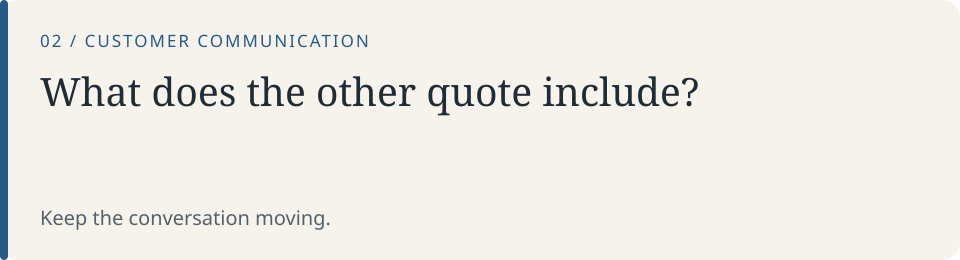
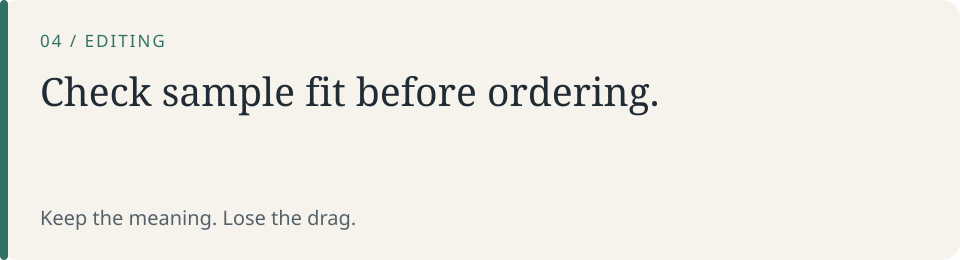
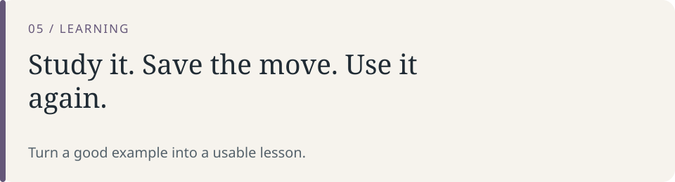

# copywriting-learning

[简体中文](README.zh-CN.md) · [See it in action](#see-it-in-action) · [Get started](#get-started)

## Find the right angle. Make every word earn its place.

Turn product facts, customer questions, and rough drafts into English copy that gives people a reason to read, something worth remembering, and a clear next step.

Sometimes you know your product inside out but haven’t found the detail that makes its value click. Sometimes a prospect goes quiet, a headline feels flat, or a draft says everything except what matters most. `copywriting-learning` helps you work through those moments—from choosing the message to finding the words.

Drawing on documented advertising cases, marketing examples, and writing lessons, it helps you uncover a relevant benefit, anticipate a reader’s question, build a persuasive sequence, and give an idea a more distinctive expression. Use it to shape an ad, explain a product, write an email, respond to a customer, or sharpen a draft that isn’t quite there yet.

The craft lives in the details: a concrete image that makes an abstract benefit tangible; a verb that brings a sentence to life; a pause that gives an idea weight; a shorter line that keeps everything essential. Each choice should serve your reader, your purpose, and the facts you can support.

You can also bring it an advertisement worth studying, a passage from a book, or feedback from your own work. Ask it to extract a reusable lesson and, with your approval, save that lesson with its source and limits for future tasks.

**v1.1.2 · 45 sourced cases and exercises · 24 searchable methods**  
[Explore the library](copywriting-learning/library/README.en.md) · [Changelog](CHANGELOG.en.md)

## See it in action


**01 · Known situation**  
You met a prospect at a trade show, discussed a relevant application, and sent an email and catalog. No reply followed. What should you send next?

*Worked example, not a customer success story.* For this demonstration, the brief specifies that the buyer needs a scale moved between workstations; the catalog lists capacity but not the scale’s own weight. The seller can confirm that weight. These are illustrative inputs, not facts about the original Sugarman case. The reason for the silence remains unknown.

**02 · Inside the skill**

| Actually consulted | What it contributes here |
| --- | --- |
| **Research the product and buyer · M-001** | Start with the buyer’s stated task rather than guessing why they went quiet. |
| **Make the next step clear · M-019** | Ask one relevant question and explain what the seller will send next. |
| [**Sugarman’s scale inquiry**](copywriting-learning/library/cases/C-sugarman-scale-buyer-questions.md) | Distinguish capacity from the product’s own weight; find missing decision information. |
| [**Zebra × Saddle Creek**](copywriting-learning/library/cases/C-zebra-saddle-creek-workflow-proof.md) | Connect a technical detail to a concrete task: moving the scale between stations. |

[Read the method records](copywriting-learning/library/catalog.json). M-024, about comparable customer evidence, was also reviewed but is **not used**: this brief supplies no matching customer deployment to cite. A relevant case supplies a writing move; it does not supply facts about your product.

**03 · Writing decision**  
Reconnect with the application discussed at the booth. Flag the missing specification and ask one question that will help assess portability. Don’t diagnose the buyer’s silence or invent urgency.

**04 · English draft**

> **Subject: A detail for moving the scale between stations**
>
> Hi [Name],
>
> At [Show], you mentioned moving the scale between workstations. The catalog I sent lists capacity, but leaves out another useful detail: what the scale itself weighs.
>
> Would your team carry it by hand or move it on a trolley? I can confirm the unit weight so you can assess how it would fit your setup.
>
> Best,  
> [Your name]

**05 · Why these words**  
“Between workstations” reconnects to a stated need. “The scale itself” removes ambiguity. The question gives the buyer a concrete point to respond to; the next sentence explains what they will receive. No claim is made that this email will secure a reply.

<details>
<summary>Copy the brief and try it with your own customer</summary>

```text
Use copywriting-learning to help me follow up with a trade-show prospect.
Here is what we discussed: [...]
Here is my last email and the material I sent: [...]
Here are the product facts and services I can confirm: [...]
Identify plausible communication gaps without inventing a reason for silence.
Read relevant cases, explain which writing moves fit, and draft one concise
English follow-up with a useful next step. Flag any missing facts.
```

</details>

## Five ways to put it to work

These are original demonstrations, not historical ad quotations or measured campaign results. Product details below are fictional exercise inputs. Each card highlights a different kind of work; the prompts and drafts remain selectable text.

### Advertising & marketing


**The facts are there. Where is the idea?**

**Exercise facts:** a notebook pairs a blank left page with a ruled right page.

> **Room for the rough draft.**
> Sketch on the left. Shape the words on the right.

<details>
<summary>Try this task · see the writing move</summary>

The headline gives a physical feature a creative purpose; the supporting line makes the page layout explicit. The benefit remains tied to the supplied design.

```text
Use copywriting-learning to write an English notebook ad. Each spread has a blank left page and a ruled right page. Write for people who sketch before writing. Give me one headline and a supporting line; don’t invent paper quality or productivity claims.
```

[Benefits: follow a feature to a relevant use](copywriting-learning/library/cases/C-vgc-benefits.md)

</details>

### Customer communication



**“Your price is too high.” What next?**

**Exercise context:** a customer compares two quotations; the competing scope is unknown. The seller can review scope but has not authorized a discount.

> Thanks for being direct. Could you share what the other quote includes—particularly delivery and support? I can compare it with ours and explain any differences.

<details>
<summary>Try this task · see the writing move</summary>

The reply acknowledges the objection, asks for comparison facts, and promises only a review. It does not invent a superior service or offer an unauthorized discount.

```text
Use copywriting-learning to reply in English to “Your price is too high.” Our quote: [...]. What we know about the competing offer: [...]. Ask for the missing comparison detail without assuming our offer is better or promising a discount.
```

[Find the information needed for a decision](copywriting-learning/library/cases/C-sugarman-scale-buyer-questions.md)

</details>

### Product benefits


**You have specifications. What should the reader care about?**

**Exercise facts:** a tool case has a removable divider; fit for the intended longer tools has been checked.

> **Make room for the longer tools.**
> Remove the divider to open up the full compartment.

<details>
<summary>Try this task · see the writing move</summary>

One physical feature becomes one useful action. The draft does not jump from adjustable storage to unverified time savings or productivity.

```text
Use copywriting-learning to turn these confirmed features into an English product headline and supporting line: [...]. Reader and task: [...]. Show the link between feature and use. Keep any fit limits.
```

[Choose the benefit the facts can support](copywriting-learning/library/cases/C-vgc-benefits.md)

</details>

### Draft diagnosis & refinement



**Correct English. Still too much work to read?**

**Exercise input:** the original draft below supplies the facts.

> **Before:** Before you proceed with placing an order, we recommend that you first check whether the sample fits your existing holder.
>
> **After:** Before ordering, check that the sample fits your existing holder.

<details>
<summary>Try this task · see the writing move</summary>

The revision preserves the sequence, the sample, and the existing holder. It removes scaffolding rather than deleting the condition that matters.

```text
Use copywriting-learning to tighten this English draft: [...]. Preserve facts, conditions, timing, terminology, and promises. Give me one revision and explain the most important wording changes.
```

[Writing guide: compress without changing meaning](copywriting-learning/references/writing.md)

</details>

### Learning from examples & feedback



**What can you actually reuse from an ad you admire?**

**Example source:** the Rolls-Royce case in the library.

> **Observation:** a small, familiar sound gives the reader a way to imagine quietness.
> **Reusable move:** find a concrete, supported detail that expresses an abstract quality.
> **Limit:** the next product needs its own evidence; the historical claim does not transfer.

<details>
<summary>Try this task · see the writing move</summary>

A learning record separates observation, interpretation, application, and limits. A later task can retrieve the move without borrowing another product’s claims.

```text
Use copywriting-learning to analyze this accessible ad or source: [...]. Separate observations from interpretations and reported results. Extract a reusable writing move and its limits. Show me the proposed record before saving it.
```

[Study the detail and the evidence behind it](copywriting-learning/library/cases/C-rolls-royce-specific-detail.md)

</details>

## Case reasoning & writing craft

**Understand the problem → retrieve a relevant case → adapt the move → refine the words.**

You don’t need to know a method number or pick a case yourself. Describe the task and supply the facts. The skill searches for a comparable writing problem, reads the relevant records, checks where the comparison holds, and writes for your reader and channel. When no case fits, it works from your facts and applicable methods rather than forcing a match.

Case selection helps decide **what to say and in what order**. Writing craft shapes **how the idea lands**: choose the benefit that matters, make abstract qualities concrete, use a short scene where appropriate, sharpen verbs, shape rhythm, and cut repetition while preserving meaning. Wordplay earns its place only when both meanings serve the message.

[Writing guide (Chinese)](copywriting-learning/references/writing.md) · [Case-based reasoning: Aamodt & Plaza](https://www.iiia.csic.es/~enric/papers/Aamodt_1994_Case.pdf)

## Build on what you learn

Bring a source the agent can read, a draft you revised, or feedback you can verify. Ask it to identify the writing move, the conditions under which it applies, and the evidence for any reported result. Review the proposed entry and authorize saving it to your writable library.

**Source → observation → reusable move → limits → approved record → retrieval in a later task.**

A note such as “this sounded like a mass email” is editorial feedback. A customer reply is evidence of that reply. Neither alone proves a sales lift. Records keep their sources, scope, and revisions so later work can build on what is actually known.

Learning here means updating external records. It does not retrain the model or run an automatic background research process. [Learning workflow (Chinese)](copywriting-learning/references/learning.md)

## Get started

Download [the skill release](https://github.com/XavierCrea/copywriting-learning/releases/latest), extract it, and keep the entire inner `copywriting-learning` folder together. The README on the default branch may be newer than the documentation bundled in the release.

For local Codex use, place that folder in your project’s `.agents/skills/` directory. Other skill-capable agents have their own installation conventions; follow your agent’s instructions. Python 3.9+ is required for the bundled library search script. The agent needs file access to the skill and library; web research needs a browsing tool, and saving learning records needs write access.

Give it three things:

1. **The deliverable and channel:** an ad, email, product page, reply, or revision; include length and tone constraints.
2. **The reader and purpose:** who will read it, what they need to decide, and the next step you want to offer.
3. **The facts and materials:** confirmed features, conditions, customer words, a source, or an existing draft. Mark what must stay and what needs checking.

You can brief in English or Chinese and request English copy. If you don’t have a polished brief, start with your notes or draft; the skill can identify possible angles and the missing facts that matter.

```text
Use copywriting-learning to help me with [task].
My reader is [audience], and I want them to [understand / decide / do].
Here are the facts, source material, or draft: [...]
Keep [...]. Don’t claim [...].
Write in English for [channel], within [length].
```

English is the primary writing focus. The detailed library notes and operating guides currently include Chinese; the [English index](copywriting-learning/library/README.en.md) helps you navigate the entries. The skill drafts content; it does not send messages or publish campaigns by itself.

## Sources & maintenance

The library contains **45 cases and exercises and 24 methods**, including 18 notes on Eddie Shleyner’s VeryGoodCopy Micro-Lessons, alongside material from Ogilvy, Sugarman, Cialdini, and public brand cases. Entries distinguish original observations, author or vendor accounts, exercises, and our interpretations. A sourced case is not automatically proof of marketing effectiveness.

[English library index](copywriting-learning/library/README.en.md) · [中文案例目录](copywriting-learning/library/README.md) · [Changelog](CHANGELOG.en.md) · [Contribute / maintain](MAINTAINING.en.md) · [Issues](https://github.com/XavierCrea/copywriting-learning/issues)

<details>
<summary>Files, library commands, and documentation maintenance</summary>

| Path | Purpose |
| --- | --- |
| [SKILL.md](copywriting-learning/SKILL.md) | Task routing and skill behavior. |
| [references/](copywriting-learning/references) | Writing, learning, and source-handling instructions. |
| [library/catalog.json](copywriting-learning/library/catalog.json) | Searchable sources, methods, cases, and feedback. |
| [scripts/library.py](copywriting-learning/scripts/library.py) | Read-only search, retrieval, and validation. |
| [docs/assets/](docs/assets) | Text-based SVG cards used by both READMEs. |

From the skill folder:

```bash
python3 scripts/library.py search "MagicStat" --kind cases --limit 3
python3 scripts/library.py get C-sugarman-magicstat-objection-sequence
python3 scripts/library.py validate
```

Use `--library "/path/to/library"` before the subcommand, or set `COPYWRITING_LIBRARY_ROOT`, to select another library. `validate --check-files` also checks locally available source files.

The English README is the main introduction; [README.zh-CN.md](README.zh-CN.md) is its Chinese counterpart. Documentation-only revisions do not change the skill version or overwrite existing release tags. Demonstrations are illustrative unless explicitly supported by actual usage evidence.

</details>
