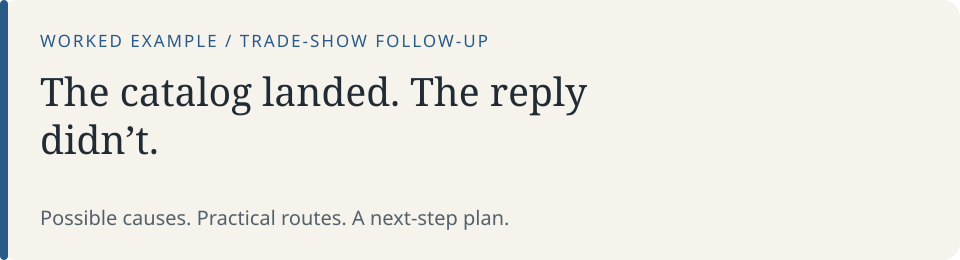
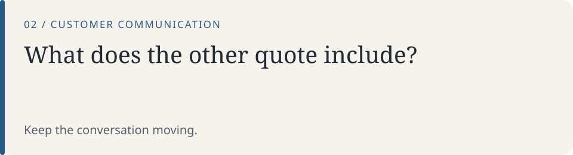
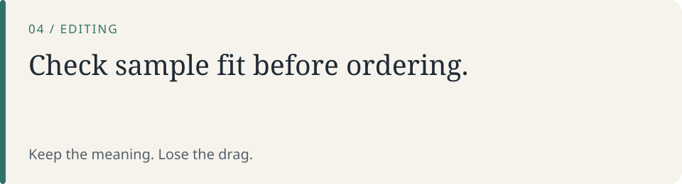

# copywriting-learning

[English](README.md) · [查看完整示范](#完整示范) · [开始使用](#开始使用)

## 找到恰当的角度，让每一个词都有价值。

把产品事实、客户问题和初稿，写成让人愿意读、能够记住，并且知道下一步的英文文案。

你可能非常了解产品，却还没有找到让价值变得鲜明的那个细节。也可能遇到客户沉默、标题平淡，或一份面面俱到却没有说到重点的草稿。`copywriting-learning` 帮你从选择信息开始，一直推敲到具体用词。

它借助有出处的广告案例、营销实例和写作课程，帮助你选择相关利益、预判读者的问题、安排说服顺序，并找到更有辨识度的表达。可以用它构思广告、解释产品、撰写邮件、回复客户，也可以打磨一份总觉得还差一点的草稿。

文字的功夫体现在细节里：用一个具体意象呈现抽象的好处，用一个动词带活句子，用停顿给观点留下分量，用更短的话保留必要的信息。每一项选择都应服务于读者、沟通目标，以及有依据的事实。

你也可以提供一则值得研究的广告、一段书籍材料，或自己的实际反馈。请它提炼可复用的经验，经你同意后，连同出处与适用边界保存下来，供后续任务检索。

**v1.1.2 · 45 个有出处的案例和练习 · 24 条可检索方法**  
[浏览案例库](copywriting-learning/library/README.md) · [更新记录](CHANGELOG.md)

## 完整示范



**01 · 已知情境**  
展会上聊得对口，发出邮件与产品目录后却没有回复。下一封该怎么写？

*以下是应用示范，不是客户成功案例。* 为了完整展示过程，本示范设定：买家需要在工作台之间移动一台秤；目录提供了承重容量，却没有标注秤本身的重量；卖方能够核实自重。这些是虚构的练习输入，不是休格曼原案例中已知的客户背景。客户沉默的原因仍然未知。

**02 · 调用了什么 · Inside the skill**

| 实际查阅的记录 | 在本示范中的作用 |
| --- | --- |
| **M-001 · 同时研究产品与目标买家** | 从客户说过的任务出发，不猜测沉默背后的心理。 |
| **M-019 · 写清真实的交易提案与下一步** | 提出一个相关问题，说明回复后卖方会提供什么。 |
| [**休格曼：秤的重量问询**](copywriting-learning/library/cases/C-sugarman-scale-buyer-questions.md) | 区分容量和自重，识别可能缺少的决策信息。 |
| [**Zebra × Saddle Creek**](copywriting-learning/library/cases/C-zebra-saddle-creek-workflow-proof.md) | 将技术细节放回“在工作台之间移动”的具体任务。 |

[方法原始记录](copywriting-learning/library/catalog.json)。本次也查阅了 M-024（挑选可比较的真实客户案例），但**未采用**：示范没有提供可以引用的同类客户部署记录。案例提供的是写作动作，不能替代当前产品的事实。

**03 · 写作判断**  
接回展位上讨论的用途，指出缺少的规格，问一个有助于判断移动方式的问题。不要擅自解释客户为什么没回复，也不要制造紧迫感。

**04 · 英文成稿**

> **Subject: A detail for moving the scale between stations**
>
> Hi [Name],
>
> At [Show], you mentioned moving the scale between workstations. The catalog I sent lists capacity, but leaves out another useful detail: what the scale itself weighs.
>
> Would your team carry it by hand or move it on a trolley? I can confirm the unit weight so you can assess how it would fit your setup.
>
> Best,  
> [Your name]

**05 · 为什么这样写**  
“Between workstations”接回已知用途；“the scale itself”明确问的是自重；问题给客户一个具体的回复切口，后一句说明能得到什么。这里展示的是写作选择，没有声称邮件一定能换来回复。

<details>
<summary>复制提示词，换成自己的客户情境</summary>

```text
用 copywriting-learning 帮我跟进一位展会客户。
当时我们讨论的是：[...]
上一封邮件和发过的资料：[...]
能够确认的产品事实与服务：[...]
识别可能的沟通缺口，不要编造客户沉默的原因。
读取相关案例，解释哪些写作动作适用，然后写一封简短的英文跟进邮件，
提供有用的下一步。缺少的关键事实请标出。
```

</details>

## 五种使用场景

以下都是本项目撰写的应用示范，不是历史广告原文或经过投放验证的成果。产品细节属于虚构的练习输入。卡片帮助快速浏览，英文成稿和提示词仍可直接复制。

### 广告营销


**信息都写对了，为什么还是让人记不住？**

练习事实：笔记本每个跨页的左页为空白，右页有横线。

> **Room for the rough draft.**
> Sketch on the left. Shape the words on the right.

<details>
<summary>试用提示词与写作依据</summary>

标题把页面结构与构思用途连接起来，说明句交代实际布局；没有编造纸张品质或效率提升。

```text
用 copywriting-learning 为笔记本写英文广告。每个跨页左侧空白、右侧横线。写给先画草图再写作的人。给一条标题和一句说明，不编造纸张品质或效率主张。
```

[查看案例](copywriting-learning/library/cases/C-vgc-benefits.md)

</details>

### 客户沟通



**客户说“价格太高”，怎样继续谈？**

练习背景：客户正在比较两份报价，竞品报价范围未知。卖方可以核对范围，但未授权折扣。

> Thanks for being direct. Could you share what the other quote includes—particularly delivery and support? I can compare it with ours and explain any differences.

<details>
<summary>试用提示词与写作依据</summary>

先接住异议，再问比较所需的事实，只承诺核对；不预设自己服务更好，也不擅自降价。

```text
用 copywriting-learning 用英文回复“Your price is too high.”。我们的报价：[...]. 已知的其他报价信息：[...]. 询问缺少的对比条件，不假设我们更好，也不要承诺折扣。
```

[查看案例](copywriting-learning/library/cases/C-sugarman-scale-buyer-questions.md)

</details>

### 产品卖点


**只有参数，怎样写出客户在意的价值？**

练习事实：工具箱隔板可以拆卸；已核对目标长工具能够放入。

> **Make room for the longer tools.**
> Remove the divider to open up the full compartment.

<details>
<summary>试用提示词与写作依据</summary>

将一个结构特点写成一个可执行的动作，利益没有跳跃成未经验证的节省时间或提高效率。

```text
用 copywriting-learning 根据已确认的功能写英文产品标题和说明：[...]. 读者与任务：[...]. 解释功能如何服务用途，保留适配限制。
```

[查看案例](copywriting-learning/library/cases/C-vgc-benefits.md)

</details>

### 旧稿诊断与精修



**英文没有错，能不能更准确、更有力量？**

练习输入：下方原稿就是本次事实来源。

> **Before:** Before you proceed with placing an order, we recommend that you first check whether the sample fits your existing holder.
>
> **After:** Before ordering, check that the sample fits your existing holder.

<details>
<summary>试用提示词与写作依据</summary>

保留先检查再下单的顺序，以及样品、现有支架等必要条件，删除冗余句式。

```text
用 copywriting-learning 精简这份英文草稿：[...]. 保留事实、条件、时间、术语和承诺。给一版改稿，解释最重要的用词变化。
```

[写作指南：保留原意的精简](copywriting-learning/references/writing.md)

</details>

### 学习与迭代


**看到好广告，怎样把这次学习用到以后？**

示范来源：库中的劳斯莱斯案例。

> **Observation:** a small, familiar sound gives the reader a way to imagine quietness.
> **Reusable move:** find a concrete, supported detail that expresses an abstract quality.
> **Limit:** the next product needs its own evidence; the historical claim does not transfer.

<details>
<summary>试用提示词与写作依据</summary>

把原文观察、机制解释、应用方式与边界分别记录，后续可以检索写法，而不会借用别人的产品主张。

```text
用 copywriting-learning 拆解这份可读取的广告或资料：[...]. 区分原文观察、自己的解释和已报告结果。提炼可复用的写作动作及限制，保存前先给我看拟入库记录。
```

[查看案例](copywriting-learning/library/cases/C-rolls-royce-specific-detail.md)

</details>

## 案例推理与写作技法

**理解问题 → 检索相关案例 → 迁移写作动作 → 打磨具体表达。**

你不需要先记住方法编号，也不用自己挑选案例。描述任务并提供事实，技能会检索相近的写作问题、读取相关记录、判断哪些条件成立，再为当前读者和渠道写稿。没有合适案例时，依据当前事实和适用方法工作，不强行套用。

案例选择帮助决定**说什么、按什么顺序说**；写作技法帮助决定**怎样让这层意思传达出来**：选择相关利益、用具体细节呈现抽象价值、按需使用短场景、推敲动词与节奏、删除重复并保留原意。双关只有在两层意思都服务于信息时才值得使用。

[写作指南](copywriting-learning/references/writing.md) · [案例推理的方法出处：Aamodt 与 Plaza](https://www.iiia.csic.es/~enric/papers/Aamodt_1994_Case.pdf)

## 学习积累

提供可读取的原始材料、改过的草稿或可以核实的反馈，请技能分析写法、适用条件以及结果证据。审阅拟入库内容后，授权保存到可以写入的资料库。

**来源 → 原文观察 → 可复用写法 → 适用边界 → 经确认的记录 → 后续检索。**

“读起来像群发”是编辑反馈；客户回信证明收到一次回复；单凭这两者，都不能证明销量增长。记录保留来源、适用范围和版本，让后续工作建立在实际已知的信息上。

这里的学习是更新外部记录，不是重新训练模型，也不会自行建立后台研究任务。[学习与更新流程](copywriting-learning/references/learning.md)

## 开始使用

从[版本页面](https://github.com/XavierCrea/copywriting-learning/releases/latest)下载源码，解压并保留里面完整的 `copywriting-learning` 文件夹。默认分支的 README 可能比版本包内的介绍更新。

在本地 Codex 项目中，把该文件夹放到 `.agents/skills/`。其他支持技能的 AI 工具请遵循其安装方式。内置检索脚本需要 Python 3.9+。执行工具需要能够读取技能与资料库；网页研究需要浏览工具；保存新记录需要文件写入权限。

提供三样信息即可开始：

1. **成品与渠道**：广告、邮件、产品页、回复或改稿，以及长度和语气要求。
2. **读者与目的**：写给谁，对方要做什么判断，希望提供什么下一步。
3. **事实与材料**：已确认功能、适用条件、客户原话、来源或旧稿。标出必须保留和待核实的内容。

可以用中文或英文交代需求，指定英文成稿。简报不完整时，也可以先提供笔记或草稿，让技能提炼候选角度、指出影响结果的资料缺口。

```text
用 copywriting-learning 帮我完成：[任务]。
读者是：[对象]，我希望对方：[理解 / 判断 / 行动]。
事实、资料或草稿：[...]
必须保留：[...]. 不能声称：[...].
用于：[渠道]，请写英文，长度：[...].
```

技能以英文文案为重点。目前详细案例笔记和运行指南仍包含中文；[英文目录](copywriting-learning/library/README.en.md)提供英文导航。技能负责准备内容，不会自行发送邮件或发布营销活动。

## 来源与维护

资料库包括 **45 个案例与练习、24 条方法**，其中有 Eddie Shleyner 的 18 篇 VeryGoodCopy 短课笔记，以及奥格威、休格曼、西奥迪尼的相关材料和公开品牌案例。记录区分原文观察、作者或厂商自述、写作练习与本项目分析。有出处不等于已经证明营销效果。

[案例目录](copywriting-learning/library/README.md) · [英文目录](copywriting-learning/library/README.en.md) · [更新记录](CHANGELOG.md) · [维护与贡献](MAINTAINING.md) · [问题反馈](https://github.com/XavierCrea/copywriting-learning/issues)

<details>
<summary>文件结构、检索命令与文档维护</summary>

| 路径 | 用途 |
| --- | --- |
| [SKILL.md](copywriting-learning/SKILL.md) | 技能入口与工作行为。 |
| [references/](copywriting-learning/references) | 写作、学习与来源处理指南。 |
| [library/catalog.json](copywriting-learning/library/catalog.json) | 可检索的来源、方法、案例与反馈。 |
| [scripts/library.py](copywriting-learning/scripts/library.py) | 只读检索、记录读取与校验。 |
| [docs/assets/](docs/assets) | 两个语言版本共同使用的 SVG 卡片。 |

在技能目录中运行：

```bash
python3 scripts/library.py search "MagicStat" --kind cases --limit 3
python3 scripts/library.py get C-sugarman-magicstat-objection-sequence
python3 scripts/library.py validate
```

在子命令前加 `--library "/path/to/library"` 或设置 `COPYWRITING_LIBRARY_ROOT` 可指定其他资料库。`validate --check-files` 还可检查本地保存的来源文件。

英文 README 为主介绍，本页为对应中文说明。仅修改文档时，不修改技能版本，不覆盖已有版本标签。没有实际使用证据的示范明确保留演示性质。

</details>
