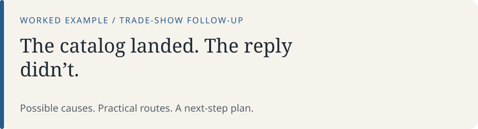

# When the catalog gets no reply

[Back to the README](../README.md) · [简体中文](trade-show-follow-up.zh-CN.md)



**01 · The problem, in the user's words**

> I met a prospect at a trade show whose needs seemed like a good fit for our products. After our conversation, I sent an email and then a product catalog. They stopped replying. How can I get them interested again?

That is the whole brief. The product, the buyer's exact requirements, and the reason for the silence are unspecified. The skill can still deliver **plausible explanations, actionable follow-up routes, a materials checklist, and a plan for what to do next**. The email structures below illustrate those routes; they are not ready-to-send messages or evidence of campaign results.

**02 · Inside the skill**

| Records consulted | How they inform the plan |
| --- | --- |
| **M-001 · Research the product and buyer** | Reconnect the catalog to the customer's task and the questions raised at the booth. |
| **M-019 · Make the next step clear** | Give each follow-up one useful, manageable next step and explain what happens after the reply. |
| **M-024 · Select relevant customer evidence** | Offer a comparable real application when suitable material exists; identify what must be checked before using it. |
| [**Sugarman's scale inquiry**](../copywriting-learning/library/cases/en/C-sugarman-scale-buyer-questions.md) | A seller's apparently complete description can still leave a buying question unanswered. |
| [**Zebra × Saddle Creek**](../copywriting-learning/library/cases/en/C-zebra-saddle-creek-workflow-proof.md) | Explain features through the customer's work, so their relevance becomes concrete. |

[Read the method records](../copywriting-learning/library/catalog.json). These cases guide the analysis and writing choices; their products, customer situations, and results do not become facts about this prospect.

**03 · What might be getting in the way?**

| Possible obstacle | What to look for in the previous exchange | Useful response |
| --- | --- | --- |
| **The catalog leaves the selection work to the buyer.** | Many products, but no explanation of which options relate to the discussion. | Narrow the options and explain the selection criteria. |
| **One important answer is still missing.** | A question about fit, certification, delivery, or implementation that the catalog does not resolve. | Answer it with a relevant specification, diagram, or other supporting material. |
| **The next step is unclear.** | A closing such as “Review the catalog and let me know if you have questions.” | Offer one concrete way to continue. |
| **The project's timing or priority has changed.** | Product information may already be sufficient, but there is no update on evaluation or purchasing. | Make it easy to explain the project's current status. |

These are hypotheses to investigate, not a diagnosis of the buyer. In Sugarman's case, capacity did not answer buyers' questions about the scale's own weight. The transferable lesson is to look for a missing decision input—not to assume that this prospect also needs weight information.

**04 · Three practical ways to restart the conversation**

The aim is to give the buyer a reason to engage again and make one small decision. That could be confirming a condition, comparing options, or clarifying timing.

**Route A · Turn the catalog into a relevant shortlist**

Use this when you know the general application but have not settled on a model. Select **one or two candidates worth evaluating**. Explain why each relates to the known need, the meaningful difference between them, and the condition that would decide the choice.

| Candidate | Connection to the need | Selection condition |
| --- | --- | --- |
| A | Which stated task or requirement it addresses. | When it is worth evaluating first. |
| B | Which relevant capability differs. | When that difference matters. |

**Prepare:** booth notes, the relevant catalog pages, candidate specifications, and one clear distinction.  
**Look for:** confirmation of a requirement or a correction to your understanding.  
**Library connection:** M-001 and Zebra's workflow approach—show why a feature matters to this customer's work.

<details>
<summary>Route A · English email structure</summary>

Use after completing the shortlist; replace the placeholders with supported details.

> **Subject: Two options for the [application] we discussed**
>
> Hi [Name],
>
> Following our conversation at [Show], I've narrowed the catalog down to two options for [application].
>
> **[Model A]** is worth considering if [condition A].  
> **[Model B]** offers [verified difference], which may matter if [condition B].
>
> Is [one deciding requirement] essential for your project? That would help narrow the choice.

If only one candidate merits evaluation, describe that one. Ask about a single condition that changes the recommendation; don't turn the email into a requirements questionnaire.

</details>

**Route B · Return to the question that was never fully answered**

Use this when the buyer raised a specific issue at the booth, or a recommendation depends on one unresolved condition. Check questions about integration, requirements, customization, sample evaluation, or delivery. Put any answer you already have first; then explain why the remaining detail matters.

**Prepare:** the customer's question, a supported answer, the relevant specification or diagram, and one remaining condition if needed.  
**Look for:** confirmation of the requirement or a more specific technical or commercial discussion.  
**Library connection:** Sugarman's buyer inquiries—use an actual question to locate a decision obstacle.

<details>
<summary>Route B · English email structure</summary>

> **Subject: On your question about [requirement]**
>
> Hi [Name],
>
> At [Show], you asked whether [specific question].
>
> [Direct answer supported by your product or service information.]
>
> The point that still needs checking is [condition], because it determines [practical consequence].
>
> Could you confirm [one specific detail]? I can then [a concrete next step you can deliver].

Share an available answer or relevant excerpt in the message. If nothing remains to be checked, remove the extra question and offer the next step that fits the conversation.

</details>

**Route C · Show how a comparable application works**

Use this when the application is understood, the buyer needs help assessing implementation, and you have a relevant example you can share. Build a short application note:

**Comparable task → configuration or approach → documented result → differences to check.**

Explain how the setup fits an existing process or meets a particular requirement. A recognizable customer name alone does not establish suitability.

**Prepare:** shareable application material, configuration, operating conditions, evidence for any result, and meaningful differences from the prospect's needs.  
**Look for:** interest in reviewing the details or discussing the application.  
**Library connection:** M-024 and Zebra—use comparable conditions and concrete work to make the example useful. If no customer case fits, use specifications, test material, or a clearly identified demonstration instead.

<details>
<summary>Route C · English email structure</summary>

> **Subject: An application example relevant to [project]**
>
> Hi [Name],
>
> Our conversation about [requirement] brought this application to mind.
>
> In [a real, shareable application], [specific configuration or approach] was used to [documented task].
>
> The relevant similarity is [shared condition]. One difference we would need to check is [difference].
>
> Would the [configuration diagram / application summary] be useful for your evaluation?

</details>

**05 · Choose a route and plan the next move**

- **A specific question remains unanswered:** start with Route B and follow through on the discussion you already had.
- **Only a general catalog has been sent:** start with Route A and make the selection easier.
- **The fit is broadly understood and a relevant application is available:** use Route C to support evaluation.

Choose one main obstacle per follow-up. These are alternatives, not three sections to combine into one long email.

| Stage | Action | What completion looks like |
| --- | --- | --- |
| **Review the exchange.** | Find the stated use, key questions, and any promised follow-up; check the address and any delivery failures. | You can describe the buyer's next decision in one sentence. |
| **Prepare one useful item.** | Make the shortlist, targeted answer, or application note for the chosen route. | The buyer can see the relevant information without reading the whole catalog. |
| **Follow up with new value.** | Reconnect to the booth conversation, give the useful information, and offer one main next step. | The buyer knows why to respond and what will happen next. |
| **Adapt to the response.** | Supply technical details for technical questions; clarify comparison terms for price questions; agree on timing if the project is delayed. | The next action reflects what the customer actually says. |

If a useful follow-up still gets no response, a later message can ask about timing:

> Is [project] still under evaluation, or would it be better to reconnect later?

Respect a stated delay. If silence continues, reduce the frequency and reconnect when you have information relevant to the need.

**Start here:** put one need the customer expressed next to one concrete piece of help you can offer. That connection gives the next contact a reason to exist.

<details>
<summary>Try this task with the information you already have</summary>

```text
Use copywriting-learning to help me with this problem:
I met a prospect at a trade show whose needs seemed like a good fit for our
products. After our conversation, I sent an email and then a catalog.
They stopped replying. How can I get them interested again?

Based on this information, explain plausible obstacles, propose practical
follow-up routes and when to choose each, and list the materials and next
steps for each route. Use relevant cases and explain what you borrow.
Keep unknowns as hypotheses. Use English templates where they help explain
the approach; a ready-to-send email is not required.
```

</details>
